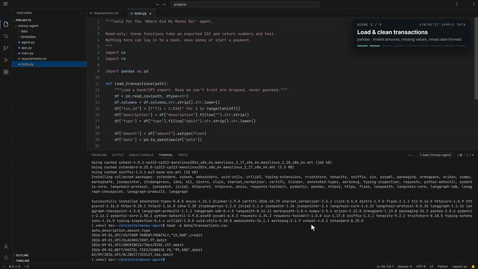
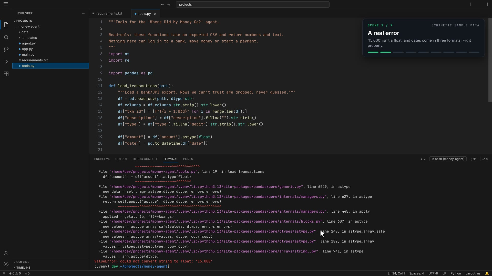
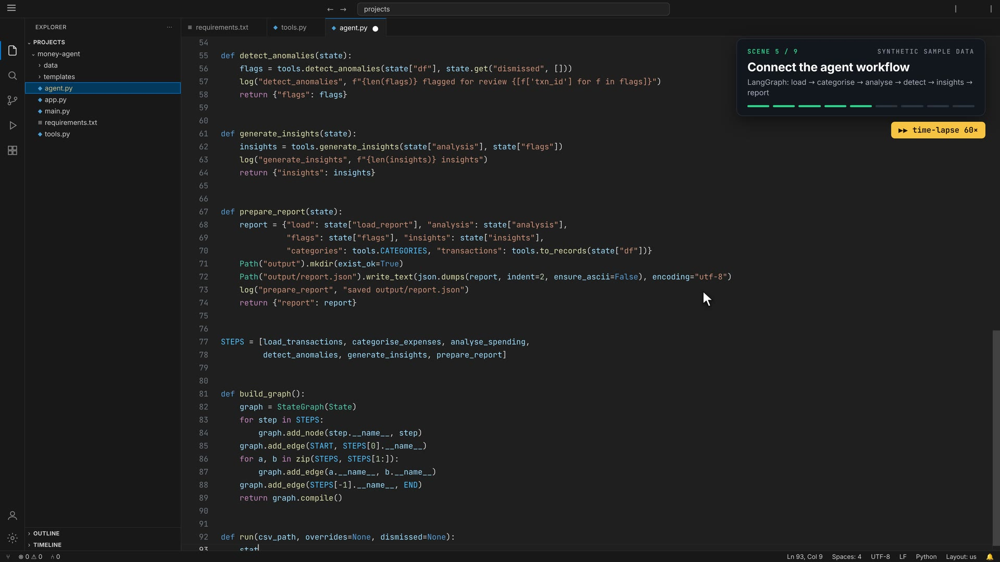
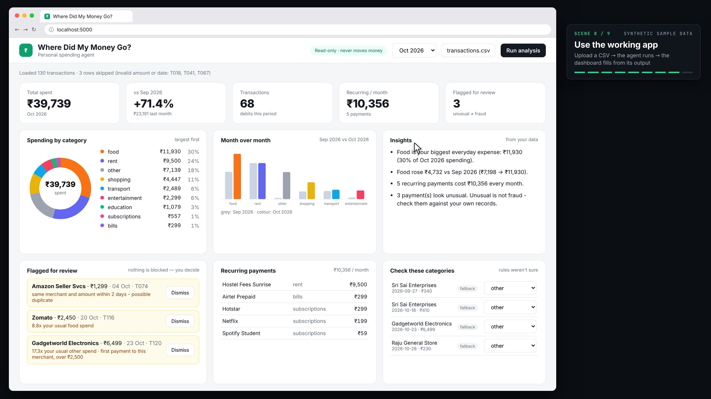
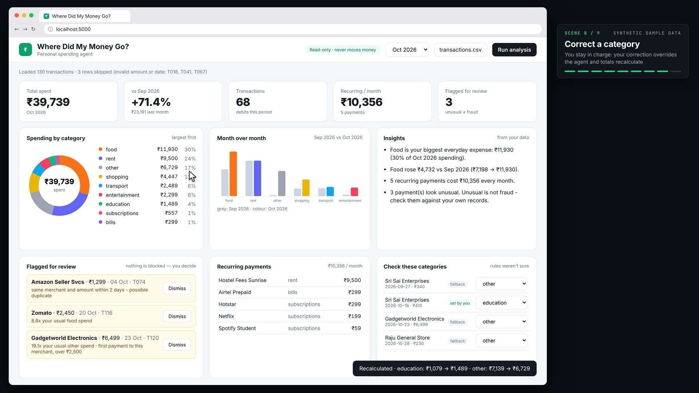

# "Where Did My Money Go?": Build-an-AI-Agent Video Generator

An 87-second, 4K, screen-recording-style video of a developer building a **personal-spending AI agent** from an empty folder:
venv and `pip install`, a real pandas crash and its fix, rule-based + optional-LLM categorisation, transparent anomaly rules,
a LangGraph workflow, a CLI run, a Flask dashboard, and finally using the app (upload → correct a category → dismiss an alert).

**Every pixel is generated by code** — no screen recorder, no AI video model. The video is one HTML page animated by JavaScript and
captured frame-by-frame with a headless browser. **Everything on screen is real**: the code being typed is the code in
`money-agent/`, and every terminal line, server log line and dashboard number comes from actually running it (`video/scripts/capture.py`).



▶ Full video: [`docs/demo-1080p.mp4`](docs/demo-1080p.mp4)

| A real error, fixed properly | The LangGraph workflow | The working dashboard | You stay in control |
|---|---|---|---|
|  |  |  |  |

More stills, one per scene: [`docs/screenshots/`](docs/screenshots)

---

## What's in this repo

| | Folder | What it is |
|---|---|---|
| **A** | `build-along/` | **Build the app yourself, step by step, exactly as in the video.** 8 steps, each with the code to type, the command to run, the real expected output, a checkpoint folder and an automatic checker. **Start here.** |
| **B** | `money-agent/` | **The finished app (the answer key), runnable for real.** pandas + LangGraph + Flask. Works offline, no API key needed. |
| **C** | `video/` | **The video generator.** HTML/CSS/JS scene engine + Python scripts that capture the app's real output and render the MP4. |

```
where-did-my-money-go-video/
├── build-along/                 ← START HERE: step-by-step guide (README.md) to build the app like the video
│   ├── step-1-setup/ … step-8-dashboard/   ← the project exactly as it is after each step + EXPECTED_OUTPUT.txt
│   ├── check_step.py            ← checks YOUR code after each step and shows what differs
│   └── make_steps.py            ← (maintainers) regenerates the steps + guide from money-agent/
├── money-agent/                 ← the finished agent (see money-agent/README.md)
│   ├── tools.py                 ← load & clean, categorise, analyse, detect anomalies, insights
│   ├── agent.py                 ← LangGraph StateGraph: 6 nodes, START → … → END
│   ├── main.py                  ← command line
│   ├── app.py                   ← Flask dashboard (upload, correct category, dismiss alert)
│   ├── templates/index.html     ← dashboard UI
│   ├── data/transactions.csv    ← synthetic sample statement (+ make_sample_data.py)
│   └── check_numbers.py         ← proves the agent reproduces the video's numbers
├── video/
│   ├── src/                     ← the video itself (open index.html?play in a browser)
│   │   ├── index.html           ← VS Code, terminal, browser + server-log mock-ups, overlays, CSS
│   │   ├── engine.js            ← drawing: syntax highlighting, typed edits (Doc), editor, terminal
│   │   ├── timeline.js          ← the script: when each file is typed, each command runs, cursor path, seek(t)
│   │   ├── dashboard.js         ← mounts the REAL money-agent/templates/index.html in a Shadow DOM
│   │   ├── captured.js          ← generated: real code versions, diffs, terminal output, reports
│   │   ├── player.js            ← live preview player (index.html?play)
│   │   └── fonts/               ← JetBrains Mono + Inter (bundled → identical output everywhere)
│   ├── scripts/
│   │   ├── check_setup.py       ← verifies Python, Playwright/Chromium, ffmpeg
│   │   ├── capture.py           ← runs the agent at every build stage → src/captured.js
│   │   ├── preview.py           ← still images at chosen seconds (fast, use while editing)
│   │   └── render.py            ← renders every frame and encodes the MP4 (1080p or 4K)
│   ├── requirements.txt
│   └── output/                  ← rendered videos land here (git-ignored)
├── docs/
│   ├── HOW_IT_WORKS.md          ← deep-dive + "change the video" tutorial + exercises
│   ├── screenshots/             ← one still per scene
│   ├── demo.gif, demo-1080p.mp4
└── LICENSE
```

---

## Part A: Build the app yourself, step by step ⭐

👉 **[build-along/README.md](build-along/README.md)**

Follow the video scene by scene and build the whole app from an empty folder:

| Step | Video | You build |
|---|---|---|
| 1 | 0:00 – 0:11 | project folders, venv, `requirements.txt`, `pip install` |
| 2 | 0:11 – 0:18 | `tools.py` v1: load the CSV, which crashes on `'15,000'` (on purpose) |
| 3 | 0:18 – 0:24 | the fix: ₹/commas, three date formats, bad rows dropped and reported |
| 4 | 0:24 – 0:34 | categorise: rules → optional LLM → `other` |
| 5 | 0:34 – 0:42 | totals, month-over-month, recurring payments, transparent anomaly rules, insights |
| 6 | 0:42 – 0:50 | `agent.py`: the LangGraph workflow |
| 7 | 0:50 – 0:56 | `main.py`: run the agent from the terminal |
| 8 | 0:56 – 1:27 | `app.py` + `templates/index.html`: the dashboard; upload, correct a category, dismiss an alert |

After every step, check your work:

```bash
python ../../build-along/check_step.py 3        # run from your my-build/money-agent folder
```

```
Checking step 3: step-3-fix-loader
  ✓ tools.py runs without an error
  ✓ 133 rows read, 3 dropped (T018, T041, T067), 130 clean
  ✓ amounts cleaned: '15,000' → 15000.0 and '₹9,500' → 9500.0
  ✓ all three date formats parsed day-first (dates run 1 Sep → 30 Oct 2026)

Step 3 done ✓ - on to step 4!
```

If a check fails, it shows the exact lines where your file differs from the checkpoint.

---

## Part B: Run the finished app (5 minutes)

**Windows (PowerShell)**
```powershell
git clone https://github.com/<your-username>/where-did-my-money-go-video.git
cd where-did-my-money-go-video\money-agent
python -m venv .venv
.venv\Scripts\activate
pip install -r requirements.txt
python check_numbers.py
python main.py data\transactions.csv
python app.py                     # open http://localhost:5000
```

**macOS / Linux**
```bash
git clone https://github.com/<your-username>/where-did-my-money-go-video.git
cd where-did-my-money-go-video/money-agent
python3 -m venv .venv
source .venv/bin/activate
pip install -r requirements.txt
python check_numbers.py           # ✓ All numbers match the video.
python main.py data/transactions.csv
python app.py                     # open http://localhost:5000
```

In the dashboard click **Choose CSV…**, pick `data/transactions.csv`, click **Run analysis**, then try correcting a category in
"Check these categories" and dismissing an alert, exactly as in scene 8. Full guide: **[money-agent/README.md](money-agent/README.md)**.

---

## Part C: Build the video yourself

### 1. Requirements

| Tool | Version | Why |
|---|---|---|
| Python | 3.10+ | runs the scripts (and the agent; langgraph needs 3.10+) |
| Playwright + Chromium | installed below | headless browser that draws each frame |
| ffmpeg | any recent | joins frames into an MP4. **Optional:** `imageio-ffmpeg` supplies one if it's missing. |

No Node.js needed. Fonts are bundled.

### 2. Install (one time, from the repo root)

**Windows**
```powershell
python -m venv .venv
.venv\Scripts\activate
pip install -r video\requirements.txt -r money-agent\requirements.txt
python -m playwright install chromium
python video\scripts\check_setup.py
```

**macOS / Linux**
```bash
python3 -m venv .venv
source .venv/bin/activate
pip install -r video/requirements.txt -r money-agent/requirements.txt
python -m playwright install chromium     # Linux may also need: python -m playwright install-deps chromium
python video/scripts/check_setup.py       # three ✓ lines
```

(The agent's requirements are only needed for `capture.py`. Rendering works without them, since `captured.js` is already included.)

### 3. Watch it live (no rendering)

Open `video/src/index.html` in Chrome / Edge / Firefox with `?play` added:

```
file:///C:/path/to/where-did-my-money-go-video/video/src/index.html?play
```

| URL | What happens |
|---|---|
| `index.html?play` | plays the whole video in real time, scaled to your window |
| `index.html?play&from=64` | starts playing at 64 s (the dashboard scene) |
| `index.html?t=30` | freezes on the exact frame at 30 s |

While playing: **Space** pause · **← / →** ±2 s · **Home** restart · **L** loop.
If your browser blocks local files, run `python -m http.server` inside `video/src/` and open `http://localhost:8000/?play`.

### 4. Stills and rendering

```bash
python video/scripts/preview.py                 # one still per scene → video/output/stills/
python video/scripts/preview.py 17.9 53.5 74    # specific seconds

python video/scripts/render.py                  # 1920×1080, 30 fps → video/output/where-did-my-money-go-1080p.mp4
python video/scripts/render.py --quality 4k     # 3840×2160         → video/output/where-did-my-money-go-4k.mp4
python video/scripts/render.py --start 64 --end 81   # just scene 8 (fast test)
```

| Option | Default | Meaning |
|---|---|---|
| `--quality` | `1080p` | `1080p` or `4k` (same layout, 2× pixel density) |
| `--fps` | `30` | frames per second |
| `--start / --end` | `0 / 87.5` | time range in seconds |
| `--workers` | CPU count (max 4) | parallel Chromium processes |
| `--crf` | 18 (1080p) / 20 (4k) | x264 quality; lower = better and bigger |
| `--keep-frames` / `--encode-only` | off | keep the JPEG frames / re-encode existing frames |
| `--out` | `video/output/…mp4` | output path |

Full video = 2,625 frames. On a 4-core laptop expect roughly 4–7 min for 1080p and 12–20 min for 4K.

### 5. Re-capture after changing the agent

If you edit anything in `money-agent/` (a rule, a keyword, the dashboard, the sample data), re-run:

```bash
python video/scripts/capture.py              # add --skip-pip to reuse the last pip transcript
python build-along/make_steps.py             # keep the step-by-step guide and checkpoints in sync
```

It runs the real code at every stage of the build (the first crashing version of `tools.py`, the fix, each run, `main.py`,
and the Flask server driven over HTTP) and rewrites `video/src/captured.js`. The video then types your new code and shows your new output.
If you changed how long a file is, you may want to adjust its typing window in `timeline.js` (see below).

---

## How it works (short version)

1. **Time is the only input.** `timeline.js` exposes `seek(t)`: given a time in seconds it sets everything — how much of each file is typed,
   which terminal lines are visible, which panel is open, where the cursor is, what the dashboard shows. No timers, so any frame can be drawn instantly, in any order.
2. **Code is typed as real diffs.** Each file is a `Doc`, a list of timed edits `{pos, del, ins, t0, t1}`. `tools.py` is built in four versions,
   and the edits between them come from `difflib`, so the video edits the file the way a person would (including fixing the crash).
3. **The dashboard is the real one.** `dashboard.js` loads `money-agent/templates/index.html` into a Shadow DOM and feeds it the JSON the real Flask server returned.
4. **Capture → render.** `render.py` opens the page in headless Chromium, calls `seek(i / 30)` and screenshots each frame; ffmpeg encodes the MP4.

➡ Full explanation, a hands-on tutorial and exercises: **[docs/HOW_IT_WORKS.md](docs/HOW_IT_WORKS.md)**

### Scene timeline

| Time | Scene | Where in the code |
|---|---|---|
| 0–11 s | 1 · Set up: folders, venv, `requirements.txt`, `pip install` | `TERM`, `DOCS['requirements.txt']` |
| 11–24 s | 2 · Load & clean: v1 crashes on `'15,000'`, fix, rerun | `tools_versions()` in `capture.py`, `DOCS['tools.py']` |
| 24–34 s | 3 · Categorise: rules → optional LLM → `other` | `TV[2]` hunks |
| 34–42 s | 4 · Analysis + transparent anomaly rules | `TV[3]` hunks |
| 42–50 s | 5 · `agent.py`: the LangGraph workflow | `DOCS['agent.py']`, `PALETTE` |
| 50–56 s | 6 · `main.py` + a real run | `DOCS['main.py']`, `T.main` |
| 56–64 s | 7 · `app.py` + dashboard HTML, start the server | `DOCS['app.py']`, `DOCS['index.html']` |
| 64–81 s | 8 · Use the app: upload, correct a category, dismiss an alert | `dashPhase`, `CUR`, `TOASTS`, `dashboard.js` |
| 81–87.5 s | 9 · Finished product: dashboard + live server log, tagline | end of `seek()` |

### Common customisations

| I want to… | Edit |
|---|---|
| Change the code that's typed | the files in `money-agent/`, then `capture.py` |
| Change typing speed / when files open | `t0, t1` in `DOCS`, and `OPEN` in `timeline.js` |
| Change terminal commands or timing | `TERM` in `timeline.js` |
| Change scene titles | `CARDS` in `timeline.js` |
| Move the mouse / add clicks | `CUR` keyframes in `timeline.js` |
| Change colours / layout / tagline | CSS and markup in `video/src/index.html` |
| Change total length | `DUR` in `timeline.js` (the scripts read it automatically) |

---

## Upload this repo to GitHub

**Option 1: website (no git needed)**
1. On github.com click **New repository**, name it `where-did-my-money-go-video`, and click **Create**.
2. Click **uploading an existing file**, unzip this project and drag in **all files and folders** (including `.gitignore`).
3. Click **Commit changes**.

**Option 2: command line**
```bash
cd where-did-my-money-go-video
git init
git add .
git commit -m "Where Did My Money Go? agent + video generator"
git branch -M main
git remote add origin https://github.com/<your-username>/where-did-my-money-go-video.git
git push -u origin main
```

Then replace `<your-username>` in this README with your GitHub username.

---

## Troubleshooting

| Problem | Fix |
|---|---|
| `Executable doesn't exist … chromium` | `python -m playwright install chromium` |
| Linux: Chromium fails to launch | `python -m playwright install-deps chromium` |
| `ffmpeg ✗` | install ffmpeg, or `pip install imageio-ffmpeg` |
| Blank page with `?play` | open via `python -m http.server` in `video/src/` |
| `capture.py` fails with `ModuleNotFoundError` | `pip install -r money-agent/requirements.txt` in the same venv |
| `check_numbers.py` shows ✗ | you edited `tools.py` or the CSV; that's fine, but the video's numbers will change after `capture.py` |
| Render is slow or runs out of memory | lower `--workers`, or render 1080p |
| macOS: `Address already in use` on port 5000 | AirPlay Receiver uses 5000: turn it off in System Settings → General → AirDrop & Handoff, or change `port=5000` in `app.py` |
| Windows: `head` not found when typing the video's commands | use `Get-Content data\transactions.csv -Head 6` (PowerShell); everything else is the same |

## Notes

* All transactions are **synthetic** (generated by `money-agent/data/make_sample_data.py`); no real person's data is used.
* The agent is read-only: no bank logins, no payments. Flagged ≠ fraud. Not financial advice.
* The LLM fallback is optional and only used if `ANTHROPIC_API_KEY` is set; the video and `check_numbers.py` run without it.

## License

MIT (see `LICENSE`). Fonts in `video/src/fonts/` are under the SIL Open Font License 1.1.
