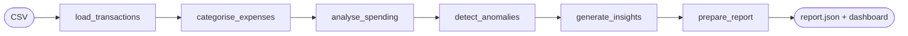

# money-agent: "Where Did My Money Go?"

A small, **read-only** personal-spending agent. Give it a bank / UPI export (CSV) and it will:

1. **load & clean**: fix `₹15,000`-style amounts and three date formats, and drop rows it can't trust (and say which)
2. **categorise**: keyword rules first, an LLM only if you configured one (and its answer is validated), otherwise `other`
3. **analyse**: totals, category split, month-over-month change, recurring payments
4. **detect anomalies**: transparent rules (3× your usual spend, a new merchant over ₹2,500, possible duplicate). *Unusual ≠ fraud.*
5. **write insights**: short sentences, each quoting the numbers behind it
6. **report**: `output/report.json`, a terminal summary and a web dashboard where **you** can correct categories and dismiss alerts

It has no tool that can log in to a bank, move money or start a payment.



## Files

| File | What it does |
|---|---|
| `tools.py` | All the logic, as plain functions you can test on their own: `load_transactions`, `categorise`, `analyse`, `detect_anomalies`, `generate_insights` and more. `python tools.py data/transactions.csv` runs a quick check. |
| `agent.py` | The workflow: a LangGraph `StateGraph` with one node per step, wired START → … → END. `run(csv, overrides, dismissed)` returns the report. |
| `main.py` | Command line: `python main.py data/transactions.csv` |
| `app.py` | Flask dashboard on http://localhost:5000: upload a CSV, correct a category (`/api/correct`), dismiss an alert (`/api/dismiss`). Your choices are saved in `output/state.json`. |
| `templates/index.html` | The dashboard UI (vanilla HTML/CSS/JS, no build step). |
| `data/transactions.csv` | 133 **synthetic** transactions for a student, Sep–Oct 2026. Includes 3 deliberately broken rows. |
| `data/make_sample_data.py` | Regenerates that CSV deterministically. |
| `check_numbers.py` | Confirms the agent reproduces the numbers in the video. |

> **Want to build this yourself, step by step, like the video?** Follow [`../build-along/README.md`](../build-along/README.md).
> This folder is the finished result (the answer key).

## Run it

Needs Python 3.10+.

```bash
cd money-agent
python -m venv .venv
source .venv/bin/activate          # Windows: .venv\Scripts\activate
pip install -r requirements.txt

python check_numbers.py            # ✓ All numbers match the video.
python tools.py data/transactions.csv
python main.py data/transactions.csv
python app.py                      # open http://localhost:5000, choose data/transactions.csv, click Run analysis
```

No API key is needed. If you want the LLM fallback for descriptions the rules can't classify:

```bash
pip install anthropic
export ANTHROPIC_API_KEY=...       # Windows: set ANTHROPIC_API_KEY=...
# optional: export MONEY_AGENT_MODEL=claude-haiku-4-5
```

The answer is only accepted if it is one of the known categories; anything else falls back to `other`.

## Use your own statement

Export transactions from your bank / UPI app as CSV with the columns `date, description, amount, type`
(`type` is `debit` or `credit`), then upload it in the dashboard or run `python main.py your.csv`.
Everything stays on your computer.

## Things to try (exercises)

1. Add keywords to `RULES` in `tools.py` (e.g. your college canteen) and watch fewer rows land in "Check these categories".
2. Add a new anomaly rule to `detect_anomalies`, e.g. "spent after midnight". Give it a clear reason string.
3. Add a "budget" input to the dashboard and an insight when a category goes over budget.
4. Add a node to the graph in `agent.py` (e.g. `forecast_next_month`) between `analyse_spending` and `detect_anomalies`.

*All data in this project is synthetic. Not financial advice.*
